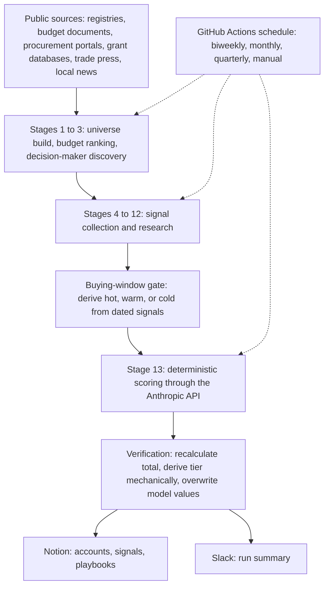
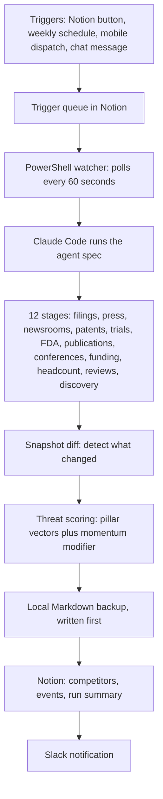

# AI Agent Pipelines: Architecture Portfolio

Two agentic intelligence pipelines, built with Claude Code and the Model Context Protocol (MCP). Each is documented at the architecture level: what it does, how the pieces fit together, and the design decisions behind it. The working implementations are kept private because they contain the sponsoring organizations' operating details.

**Author:** Nick Oberheide | Indianapolis, IN | linkedin.com/in/nickoberheide

## How these were built

Both were built with Claude Code. Each pipeline is an agent specification (stage definitions, source policy, scoring rules, and verification logic) that Claude Code executes, with Notion as the data store and Slack for notifications. They are spec-driven agent systems, not conventional application codebases. The competitive intelligence pipeline also includes PowerShell scripts that poll a trigger queue and launch runs on a Windows host.

---

## 1. Sales Intelligence Agent Pipeline

A 13-stage agentic pipeline that builds, ranks, and researches a list of 120 public-sector accounts for a B2G sales team, using only free public sources. Full specification: [`docs/sales-intelligence-spec.md`](docs/sales-intelligence-spec.md).

### What it does

- Builds a universe of public-sector agencies from public registries and directories, ranks them by published budget, and promotes the top 120 to an active list.
- Identifies named decision-makers under a verification-first rule.
- Collects dated buying signals from public sources: trade press, procurement portals, grant databases, oversight board records, leadership changes, and local news.
- Scores every account with a deterministic model, then verifies the model's arithmetic before anything is saved.
- Delivers a ranked account list with a short playbook per account to Notion, and a run summary to Slack.

### Architecture

### Design decisions

1. **Separate stages, never collapsed.** Ranking, contact discovery, signal collection, and scoring are distinct stages. A failure in one is logged and the run continues, so a single bad source cannot abort a full run.
2. **Source tiers and corroboration.** Sources are ranked from authoritative government records down to aggregators. A lower-tier signal cannot be promoted to high significance without corroboration from a higher tier, and every signal carries a source URL. A signal with a missing citation is dropped, not logged.
3. **Staleness is a quality dimension.** A signal older than 18 months does not count as current, unless it is a multi-year contract whose renewal window is approaching.
4. **The buying window is derived before scoring.** A gate computes hot, warm, or cold from the dated signals linked to each account, then passes the result to the scoring step as a fixed input. The model never re-derives it, so the window reflects current dates and not stale stored values.
5. **The model's arithmetic is not trusted.** After each scoring call, a verification step recalculates the total from the component values and derives the tier mechanically. Any mismatch is logged, and the stored score and tier are always overwritten with the mechanical values.
6. **Failure-safe writes.** A backup is written before any database write. If a scoring call fails or returns unparseable output, no scoring fields are written and the existing values stay. A fallback or zeroed score is never written over a real one.
7. **Playbooks cannot drift.** Playbook text never embeds scores. After scoring, any account whose score moved by more than one point has its playbook regenerated.
8. **Responsible collection.** Free public sources only, no paid data brokers. A blocked source is skipped and logged, a rate limit gets one retry after a pause, and bot detection is never bypassed.

---

## 2. Competitive Intelligence Agent Pipeline

A 12-stage agentic pipeline that tracks about 20 competitors of a healthcare AI company across public data sources, detects what changed, scores each competitor's threat level against the company's product pillars, and delivers executive-ready summaries. Full specification: [`docs/competitive-intelligence-spec.md`](docs/competitive-intelligence-spec.md).

### What it does

- Runs a sweep across regulatory filings, patents, clinical trials, FDA data, publications, trade press, company newsrooms, conference abstracts, funding and headcount signals, and software review sites.
- Detects change by comparing each competitor against a stored snapshot, and logs each material change as a dated, sourced event.
- Scores every competitor with a weighted threat model: binary checks against five product pillars plus a market momentum modifier, mapped to High, Medium, or Low with a monitoring cadence for each.
- Finds new entrants and holds them for human review.
- Writes updates to Notion, a run summary page, a local backup, and a Slack notification. A full sweep took 13 to 19 minutes in its first runs.

### Architecture

### Design decisions

1. **One queue, four triggers.** A Notion button, a weekly schedule, a mobile dispatch task, and a chat message all write a row to the same trigger queue, so every run takes a single execution path no matter how it started.
2. **A thin deterministic wrapper around an agent.** A polling script owns scheduling, status updates, and locking. The agent owns the research. Two pipelines on the same host share no state: each has its own directory, scheduled task, and lock.
3. **Backup first.** A local Markdown copy of the run is written before any API write, so the output exists even if Notion is unavailable.
4. **Source tiers and corroboration.** Filings and government databases rank above trade press, which ranks above self-reported and aggregator sources. A lower-tier source cannot support a high-significance event on its own, and headcount estimates from search are treated as directional only.
5. **Change detection by snapshot diff.** After each run, a per-competitor snapshot is saved. Events come from differences against it, and a newsroom page change above a size threshold is flagged for manual review instead of being labeled a launch automatically.
6. **Scoring is binary and grounded in product language.** Each pillar is a yes or no check against public product descriptions, which is more reliable than inferring maturity. Pillars that are hard to detect use proxy phrases. The momentum modifier keeps funding signal in the score without letting it dominate, and a threat level is never left blank.
7. **Humans gate discovery.** The discovery stage has a high false-positive rate, so new entities are written as Unverified and promoted by a person. Auto-promotion is never enabled.
8. **Built for executives, not engineers.** The competitor database is a gallery grouped by threat level, with a Slack summary and a one-click trigger. The tooling is infrastructure, and the output is the product.

---

## Contents

- [`docs/sales-intelligence-spec.md`](docs/sales-intelligence-spec.md): sanitized agent specification for the sales intelligence pipeline.
- [`docs/competitive-intelligence-spec.md`](docs/competitive-intelligence-spec.md): sanitized agent specification for the competitive intelligence pipeline.

## Not included

The working implementations, prompts, signal definitions and scoring weights, account and competitor lists, customer and pricing information, contact data, and workspace identifiers.
