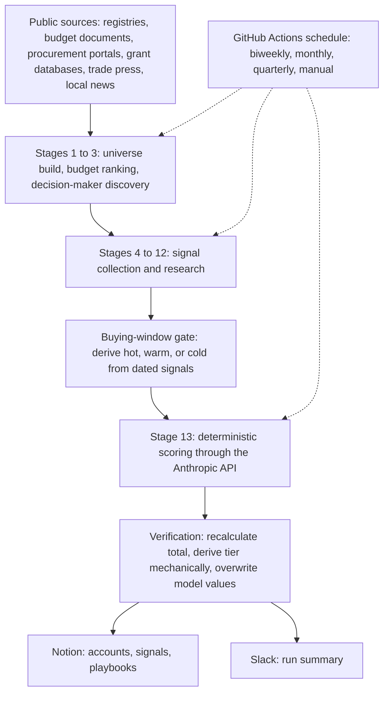

# Sales Intelligence Agent Pipeline: Architecture Portfolio

A 13-stage agentic pipeline that builds, ranks, and researches a list of 120 public-sector accounts for a B2G sales team, using only free public sources. This repository documents the design. The working implementation is kept private because it contains the sponsoring organization's operating details.

**Author:** Nick Oberheide | Indianapolis, IN | linkedin.com/in/nickoberheide

## How it was built

Built with Claude Code. The pipeline is an agent specification (stage definitions, source policy, scoring rules, and verification logic) that Claude Code executes on a GitHub Actions schedule, with Notion as the data store and Slack for run summaries. It is a spec-driven agent system, not a conventional application codebase.

## What it does

- Builds a universe of public-sector agencies from public registries and directories, ranks them by published budget, and promotes the top 120 to an active list.
- Identifies named decision-makers under a verification-first rule.
- Collects dated buying signals from public sources: trade press, procurement portals, grant databases, oversight board records, leadership changes, and local news.
- Scores every account with a deterministic model, then verifies the model's arithmetic before anything is saved.
- Delivers a ranked account list with a short playbook per account to Notion, and a run summary to Slack.

## Architecture

## Design decisions

1. **Separate stages, never collapsed.** Ranking, contact discovery, signal collection, and scoring are distinct stages. A failure in one is logged and the run continues, so a single bad source cannot abort a full run.
2. **Source tiers and corroboration.** Sources are ranked from authoritative government records down to aggregators. A lower-tier signal cannot be promoted to high significance without corroboration from a higher tier, and every signal carries a source URL. A signal with a missing citation is dropped, not logged.
3. **Staleness is a quality dimension.** A signal older than 18 months does not count as current, unless it is a multi-year contract whose renewal window is approaching.
4. **The buying window is derived before scoring.** A gate computes hot, warm, or cold from the dated signals linked to each account, then passes the result to the scoring step as a fixed input. The model never re-derives it, so the window reflects current dates and not stale stored values.
5. **The model's arithmetic is not trusted.** After each scoring call, a verification step recalculates the total from the component values and derives the tier mechanically. Any mismatch is logged, and the stored score and tier are always overwritten with the mechanical values.
6. **Failure-safe writes.** A backup is written before any database write. If a scoring call fails or returns unparseable output, no scoring fields are written and the existing values stay. A fallback or zeroed score is never written over a real one.
7. **Playbooks cannot drift.** Playbook text never embeds scores. After scoring, any account whose score moved by more than one point has its playbook regenerated.
8. **Responsible collection.** Free public sources only, no paid data brokers. A blocked source is skipped and logged, a rate limit gets one retry after a pause, and bot detection is never bypassed.

## Contents

- [`docs/pipeline-spec.md`](docs/pipeline-spec.md): a sanitized version of the agent specification.

## Not included

The working implementation, prompts, signal definitions and scoring weights, account lists, customer and pricing information, contact data, and workspace identifiers.
